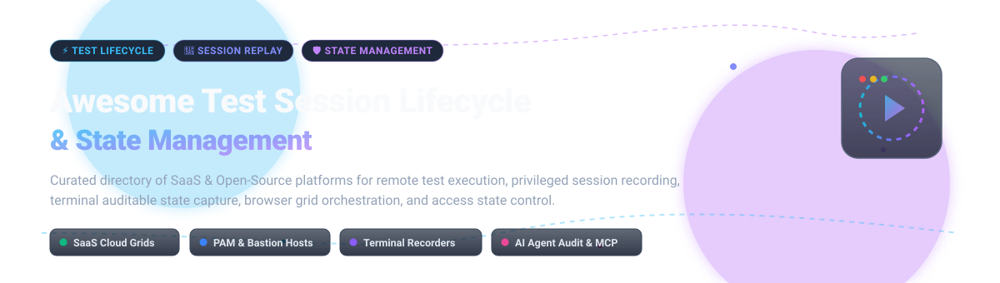

# Awesome Test Session Lifecycle & State Management 🚀

 

  <strong>A curated directory of top Test Session Lifecycle and State Management platforms</strong> 
  Comprehensive guide covering enterprise SaaS cloud testing infrastructure, privileged access management (PAM), bastion hosts, clientless web gateways, terminal recording tools, and AI agent session audit state.

🌟 *Star this repository if you find it helpful!* 🌟

---

## 📑 Table of Contents

- [🌐 Sector Overview & Market Dynamics](#-sector-overview--market-dynamics)
- [🟦 SaaS & Hosted Platforms](#-saas--hosted-platforms)
- [🟩 Open-Source Software](#-open-source-software)
- [📊 Comparison Matrix at a Glance](#-comparison-matrix-at-a-glance)
- [💡 Architectural Integration Patterns](#-architectural-integration-patterns)
- [🤝 Contributing](#-contributing)
- [📄 License](#-license)

---

## 🌐 Sector Overview & Market Dynamics

The global market for **Privileged Access Management (PAM), remote session infrastructure, and automated test session state management** is valued at approximately **$4.5 Billion to $7.8 Billion** as of 2026, advancing at a compound annual growth rate (CAGR) of **18.2% to 22.4%** toward a projected **$16B–$24B+** by the early 2030s.

The sector exhibits **moderate fragmentation across specialized functional niches**: enterprise privileged access security and compliance recording are led by consolidated powerhouses (CyberArk, BeyondTrust, Teleport), while automated test execution session infrastructure remains anchored by specialized device/browser grids (BrowserStack, Sauce Labs, AWS Systems Manager) and rapidly expanding open-source bastion gateways and terminal session replay engines.

---

## 🟦 SaaS & Hosted Platforms

Commercial, cloud-hosted Test Session Lifecycle and State Management platforms. The table below is sorted in descending order of company scale (enterprise valuation or revenue).

| Platform | Valuation / Revenue Scale | Starting Price | Free Tier / Trial Limits | Key Capabilities & Session Management | Best For |
|---|---|---|---|---|---|
| **[AWS Systems Manager Session Manager](https://aws.amazon.com/systems-manager/)** | **~$2.1T Market Cap** (AWS Revenue: ~$107B ARR) | **$0.05 / session** (for on-premises / hybrid nodes; $0 for EC2) | **Free Forever Tier** ($0 for standard EC2 instances; free registration of hybrid nodes) | Inbound-portless shell & CLI session state; IAM RBAC policy enforcement; encrypted CloudWatch & S3 session logging | AWS-centric cloud infrastructure & hybrid nodes needing auditable CLI access without SSH keys |
| **[CyberArk Privileged Session Manager](https://www.cyberark.com/)** | **~$25.0B Valuation** (Acquired by Palo Alto Networks; ~$1.3B ARR) | **~$400 – $700 / user / year** (Privilege Cloud bundle, annual billing) | **Guided Proof-of-Concept (PoC)** (no public self-serve free trial; evaluation tenancy upon request) | Zero-trust privileged session isolation; transparent compressed text-format session capture; risk scoring integration | Large enterprise security operations requiring non-bypassable privileged session isolation & compliance auditing |
| **[LogMeIn Central (GoTo)](https://www.logmein.com/pro/central)** | **~$4.3B Valuation** (~$1.0B Revenue) | **$80.00 / month** (billed annually, Central Base tier) | **14-Day Free Trial** (full feature evaluation; no credit card required upfront) | Remote control sessions across Windows, macOS, iOS, Android; multi-monitor switching; patch management & remote execution state | MSPs and enterprise IT support teams needing multi-endpoint remote desktop session orchestration |
| **[BrowserStack Automate Sessions](https://www.browserstack.com/automate)** | **~$4.0B Valuation** (~$230M ARR) | **$129.00 / month** (billed annually; 1 parallel session) | **Free Trial with 100 Automated Minutes** (includes video, raw network HAR, and console logs) | Automated test execution lifecycle API; session state querying (running/done/timeout/failed); video & HAR artifact capture | QA engineering & CI/CD pipelines needing programmatic test session lifecycle tracking and artifact extraction |
| **[BeyondTrust Privileged Remote Access](https://www.beyondtrust.com/products/privileged-remote-access)** | **~$1.5B+ Valuation** (~$500M ARR) | **~$1,500 – $3,000 / year** (entry-level vendor access bundle) | **14-Day Free Trial** (complete hands-on access to vendor session isolation & audit capture) | Mandatory access justification; AI-generated session summaries; keystroke-level logging; in-session credential injection | Security teams wanting automated AI summaries of privileged access sessions & vendor access boundaries |
| **[Teleport Session Recording](https://goteleport.com/)** | **~$1.1B Valuation** ($50M+ ARR) | **$0 / month** (Community Edition; Enterprise Cloud custom quote) | **14-Day Free Trial** (Enterprise Cloud) / **Free Forever** (Community AGPLv3 Edition) | Identity-aware SSH, Kubernetes, RDP, and database session recording; JSON structured audit logs; RBAC playback gating | Zero-trust engineering access requiring role-aware session recording, SIEM streaming, and replay verification |
| **[AnyDesk Session Management](https://anydesk.com/)** | **~$660M Valuation** (~$100M ARR) | **$23.12 / month** (Solo Plan, billed annually) | **Free Forever Tier** (strictly personal/non-commercial use) / **14-Day Business Trial** | Proprietary DeskRT codec; remote session requests & queue management; unattended access with password; screen recording | IT helpdesks, remote support operators, and solo developers requiring low-latency remote desktop control |

---

## 🟩 Open-Source Software

Self-hosted, community-driven session lifecycle, recording, and state management tools. Sorted in descending order of GitHub star popularity.

| Project | GitHub Stars | Primary Language / Stack | License | Core Focus & Architecture |
|---|---|---|---|---|
| **[JumpServer](https://github.com/jumpserver/jumpserver)** |  | Python, Django, Docker | GPL-3.0 | Centralized bastion host and Privileged Access Management (PAM) gateway. Provides web-based terminal and remote desktop access for SSH, RDP, Telnet, VNC, and database connections with full session recording, real-time monitoring, command filtering, and multi-factor authentication. |
| **[Teleport Community](https://github.com/gravitational/teleport)** |  | Go, Rust | AGPL-3.0 | Identity-native infrastructure access plane. Replaces static credentials with short-lived X.509 certificates and SSH credentials. Automatically logs and records every SSH, Kubernetes, Windows RDP, and web application session with instant audit event streaming and web player replay. |
| **[asciinema](https://github.com/asciinema/asciinema)** |  | Rust, Python | GPL-3.0 | Standard terminal session recorder. Captures pure terminal ANSI escape sequences with sub-millisecond timestamp precision into lightweight JSON/cast transcripts without video bloat. Transcripts can be searched, copy-pasted, and replayed in any terminal or web page via JS player. |
| **[noVNC](https://github.com/novnc/noVNC)** |  | JavaScript, HTML5 WebSockets | MPL-2.0 | HTML5 VNC client library and web viewer. Connects web browsers directly to remote graphical desktop sessions over WebSockets without third-party plugins. Widely integrated into containerized test environments, cloud VM consoles, and remote browser isolation systems. |
| **[tmate](https://github.com/tmate-io/tmate)** |  | C | MIT | Instant terminal sharing and session broadcasting multiplexer built on tmux. Spawns an encrypted SSH/TLS tunnel to facilitate live pair programming, interactive CI/CD job debugging (e.g. GitHub Actions runner debugging), and remote team terminal inspection. |
| **[Apache Guacamole](https://github.com/apache/guacamole-server)** |  | C, Java, JavaScript | Apache-2.0 | Enterprise-grade clientless remote desktop gateway supporting RDP, VNC, and SSH over HTML5. Supports graphical session screen recording, optional keystroke logging (`recording-include-keys`), Dockerized deployments, and dual-mode REST API integration. |
| **[Selenoid](https://github.com/aerokube/selenoid)** |  | Go, Docker | Apache-2.0 | Ultra-fast Selenium/WebDriver test session hub that spawns browsers inside lightweight, isolated Docker containers on demand. Automatically manages session lifecycles, captures browser video recordings per test session, exposes live VNC debug streams, and cleans up containers upon session termination. |
| **[Remmina](https://github.com/FreeRDP/Remmina)** |  | C, GTK | GPL-2.0 | Versatile open-source remote desktop client for Linux and Unix-like workstations. Supports multi-protocol connections (RDP, VNC, SPICE, SSH, SFTP, WWV), tabbed session state management, SSH tunneling, and display scaling. |
| **[The Bastion (OVHcloud)](https://github.com/ovh/the-bastion)** |  | Perl, Shell | GPL-3.0 | High-security SSH jump-host solution used to authenticate, authorize, and record privileged SSH sessions. Provides cryptographically signed session recording, PTY capture, multi-account group access, and hardware MFA token enforcement. |
| **[ShellWarden](https://github.com/MohamedXIV/shellwarden)** |  | Go, TypeScript, Docker | MIT | Local-first and self-hosted control center for safely exposing shell access to AI agents and operators over MCP. Provides real-time activity capture, time-boxed access approvals, asciinema-based session recording, and immutable audit logs. |
| **[Shellguard](https://github.com/shazeus/shellguard)** |  | Python | MIT | Lightweight terminal session recorder and security auditor. Captures PTY session streams into portable JSONL transcripts with timing metadata, scans command streams for leaked API tokens/keys, and generates standalone HTML audit reports. |
| **[MCP Session Recorder](https://github.com/mizcausevic-dev/mcp-session-recorder)** |  | Python, FastAPI | MIT | Dedicated Model Context Protocol (MCP) session replay service. Captures AI agent tool execution state, approval histories, evidence chains, and operator-facing audit logs for compliance in autonomous coding workflows. |

---

## 📊 Comparison Matrix at a Glance

| Software | License / Model | Primary Category | Session Recording Format | Live Session Replay | Self-Hosted Ready | Best For |
|---|---|---|---|---|---|---|
| **AWS SSM Session Manager** | SaaS (Proprietary) | Cloud Infrastructure Access | Encrypted Text / Log Streams | ❌ (Logs in S3/CloudWatch) | ❌ | Portless AWS & hybrid node shell access |
| **CyberArk PSM** | SaaS / Self-Hosted (Proprietary) | Enterprise PAM | Text & Keystroke Vault Record | ✅ (Searchable Player) | ❌ (Cloud) / ✅ (On-Prem) | Mission-critical compliance & threat scoring |
| **LogMeIn Central** | SaaS (Proprietary) | IT Endpoint Management | Video / Screen Recording | ✅ (Remote Viewer) | ❌ | Multi-OS fleet administration & remote control |
| **BrowserStack Automate** | SaaS (Proprietary) | Test Execution Grid | Video, HAR & Framework Logs | ✅ (Web Console) | ❌ | Automated CI/CD test session tracking |
| **BeyondTrust PRA** | SaaS / Appliance (Proprietary) | Privileged Remote Access | Video + Keystrokes + AI Summary | ✅ (Indexed Video Player) | ❌ (Cloud) / ✅ (Appliance) | AI-powered privileged vendor session audits |
| **Teleport** | Commercial / AGPL-3.0 OSS | Zero-Trust Access Gateway | Protocol Audit + Cast Stream | ✅ (Interactive Web/CLI Replay) | ✅ | Role-based SSH, Kubernetes & DB session replay |
| **AnyDesk** | Freemium (Proprietary) | Remote Support Client | Video / Screen Recording | ✅ (Native Viewer) | ❌ | Ultra-responsive desktop screen control |
| **JumpServer** | Open-Source (GPL-3.0) | Web Bastion / PAM | Terminal Cast & Graphical Video | ✅ (Web Replay UI) | ✅ | Centralized multi-protocol bastion security |
| **asciinema** | Open-Source (GPL-3.0) | Terminal Recorder | Portable JSON/Asciicast v2 | ✅ (Terminal & JS Player) | ✅ | Terminal recordings & text-searchable demos |
| **noVNC** | Open-Source (MPL-2.0) | WebSocket VNC Gateway | Raw RFB Protocol Frames | ❌ (Viewer only) | ✅ | Plugin-free browser-based graphical consoles |
| **tmate** | Open-Source (MIT) | Terminal Multiplexer | Terminal Buffer Streams | ✅ (Live Interactive Mirror) | ✅ | Remote pairing & CI runner troubleshooting |
| **Apache Guacamole** | Open-Source (Apache-2.0) | Clientless Remote Desktop | Graphical Video & Key Logs | ✅ (guacenc Player) | ✅ | Browser-based RDP/VNC/SSH bastion gateway |
| **Selenoid** | Open-Source (Apache-2.0) | Containerized Grid | MP4 Video & Execution Logs | ✅ (Video Artifacts) | ✅ | Scalable Docker browser test execution |
| **Remmina** | Open-Source (GPL-2.0) | Desktop Remote Client | Local Screenshots / Notes | ❌ | ✅ (Workstation Client) | Linux workstation multi-protocol connectivity |
| **The Bastion** | Open-Source (GPL-3.0) | SSH Bastion Host | Cryptographic PTY Logs | ✅ (CLI Audit Replay) | ✅ | High-assurance enterprise SSH access boundaries |
| **ShellWarden** | Open-Source (MIT) | AI Agent / PAM Control | asciinema v2 Cast Logs | ✅ (Click-to-Seek Timeline) | ✅ | Local-first AI agent shell permission gates |
| **Shellguard** | Open-Source (MIT) | Terminal Security Auditor | JSONL Transcripts | ✅ (CLI Replay Engine) | ✅ | CLI security analysis & leaked token audits |
| **MCP Session Recorder**| Open-Source (MIT) | AI Tool Session Auditor | Structured Tool Run Traces | ✅ (HTML Replay Board) | ✅ | Model Context Protocol tool verification |

---

## 💡 Architectural Integration Patterns

When implementing test session lifecycle and remote state management across software development and infrastructure pipelines, engineering teams typically implement one of three standard architectures:

### 1. 🔄 Ephemeral Test Execution Containers (Local / On-Premise)
* **Design:** Tests in CI/CD trigger containerized browser engines (e.g. [Selenoid](https://github.com/aerokube/selenoid)) over WebDriver or Chrome DevTools Protocol (CDP).
* **Lifecycle State:** Each test instance receives a fresh, isolated container. Video recordings (`.mp4`) and network traces are created alongside execution state (running, passed, failed), streamed to object storage, and the container is immediately destroyed.

### 2. 🔐 Zero-Trust Privileged Session Gateways (Production & Staging)
* **Design:** Developers and automated maintenance agents connect through identity-aware proxy gateways (e.g. [Teleport](https://github.com/gravitational/teleport), [JumpServer](https://github.com/jumpserver/jumpserver), or [Apache Guacamole](https://github.com/apache/guacamole-server)).
* **Lifecycle State:** Short-lived TLS/SSH certificates are minted via OIDC/SAML. The gateway acts as a protocol broker, terminating inbound traffic, enforcing RBAC, and streaming immutable, timestamped session events directly to SIEM or compliance vaults.

### 3. 🤖 AI Agent Execution & MCP Session Auditing
* **Design:** Autonomous coding and operations agents interact with environments through Model Context Protocol (MCP) or shell wrappers (e.g. [ShellWarden](https://github.com/MohamedXIV/shellwarden), [MCP Session Recorder](https://github.com/mizcausevic-dev/mcp-session-recorder)).
* **Lifecycle State:** Every tool invocation, shell command, stdout/stderr delta, and human-in-the-loop approval step is indexed in structured JSONL transcripts for post-run forensic replay and regression benchmarking.

---

## 🤝 Contributing

Contributions are warmly welcome! To propose a new open-source session tool or update SaaS product details:

1. 🍴 Fork this repository.
2. 🔍 Verify the project is actively maintained (active releases or commits within the last 12 months).
3. 🏷️ Ensure open-source entries include the correct GitHub star badge linked to its `/stargazers` page (`https://img.shields.io/github/stars/{owner}/{repo}?style=social&color=white`).
4. 🚀 Submit a detailed Pull Request.

---

## 📄 License

This repository is curated and made available under the [CC0 1.0 Universal (Public Domain)](http://creativecommons.org/publicdomain/zero/1.0/) license. Individual tools, libraries, and frameworks retain their respective open-source or proprietary licenses.

  ⭐ <strong>If you find this repository valuable, please consider starring it!</strong> ⭐

